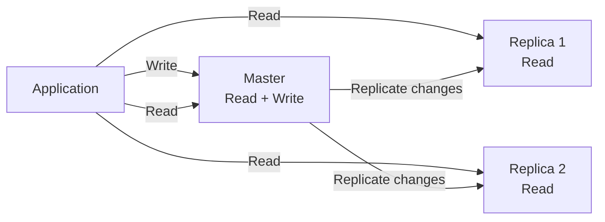
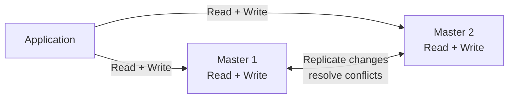

# What is Database Replication?

Database replication adalah proses menyalin dan menjaga data pada beberapa database agar salinan tersebut tetap selaras. Salinan database disebut replica. Replication dapat meningkatkan availability, fault tolerance, dan kemampuan sistem melayani beban baca.

Replication bukan pengganti backup. Replica yang mengikuti perubahan secara langsung juga dapat ikut menerima kesalahan atau penghapusan data; backup tetap diperlukan untuk pemulihan data historis.

# Why Does Database Replication Matter?

Satu database dapat menjadi bottleneck atau single point of failure ketika seluruh traffic bergantung padanya. Dengan replica, sistem dapat membagi query baca ke beberapa node dan tetap menyediakan layanan ketika sebuah node mengalami gangguan.

Replication juga membawa trade-off: data antar-node mungkin tidak langsung sama, mekanisme failover menambah kompleksitas, dan semakin banyak node yang perlu dikoordinasikan.

# Master-Slave Replication

Pada pola master-slave, satu node bertindak sebagai master (sering juga disebut primary), menerima operasi baca dan tulis. Perubahan pada master kemudian direplikasi ke satu atau lebih slave (replica/secondary), yang biasanya melayani operasi baca saja.

Replica dapat meneruskan perubahan ke replica lain sehingga membentuk struktur tree. Jika master gagal, replica masih dapat melayani pembacaan, tetapi sistem belum dapat menerima penulisan sampai sebuah replica dipromosikan menjadi master atau master baru disiapkan.

## Advantages

- Query baca dapat dibagi ke replica sehingga beban baca pada master berkurang.
- Backup dapat dijalankan dari replica dengan dampak yang lebih kecil terhadap master.
- Replica dapat dilepas sementara lalu disinkronkan kembali tanpa menghentikan seluruh sistem.
- Alur penulisan relatif sederhana karena hanya satu node yang menerima write.

## Disadvantages

- Membutuhkan hardware tambahan serta proses operasional dan pemantauan yang lebih kompleks.
- Kegagalan master dapat menyebabkan downtime untuk penulisan dan berpotensi kehilangan perubahan yang belum sempat direplikasi.
- Semua write tetap terpusat pada master, sehingga kapasitas penulisan tidak terbagi.
- Replica dapat tertinggal dari master (replication lag), terutama saat volume write tinggi atau jumlah replica bertambah.
- Pembacaan dari replica mungkin menghasilkan data yang stale.

# Master-Master Replication

Pada pola master-master, kedua (atau lebih) node dapat menerima operasi baca dan tulis. Node-node tersebut mereplikasi perubahan satu sama lain. Jika satu master gagal, node lain dapat tetap melayani read dan write, bergantung pada konfigurasi dan kesehatan cluster.

## Advantages

- Aplikasi dapat membaca dari beberapa master.
- Beban penulisan dapat dibagi ke beberapa node.
- Failover dapat berlangsung cepat karena node lain sudah menerima operasi baca dan tulis.

## Disadvantages

- Setup, deployment, dan operasi lebih kompleks dibanding master-slave.
- Perubahan serentak pada data yang sama dapat menimbulkan write conflict yang harus diselesaikan.
- Sinkronisasi yang lebih ketat dapat menambah write latency; sinkronisasi yang lebih longgar dapat membuat data sementara tidak konsisten.
- Menambah node penulis memperbesar kemungkinan konflik dan biaya koordinasi.

# Synchronous vs Asynchronous Replication

Istilah synchronous dan asynchronous menjelaskan kapan sebuah write dianggap selesai dibandingkan dengan proses penyalinan ke replica.

## Synchronous Replication

Pada synchronous replication, operasi write menunggu konfirmasi dari replica yang ditentukan sebelum dianggap berhasil. Dengan demikian, data pada primary dan replica yang mengonfirmasi write lebih terjaga keselarasan terbarunya.

Keuntungannya adalah risiko kehilangan write yang sudah dikonfirmasi lebih rendah ketika primary gagal. Namun, write latency dapat meningkat karena harus menunggu komunikasi jaringan dan replica. Jika replica tidak tersedia, write juga dapat tertunda atau gagal, sesuai kebijakan sistem.

## Asynchronous Replication

Pada asynchronous replication, primary mengonfirmasi write terlebih dahulu, lalu perubahan dikirim ke replica setelahnya. Proses ini biasanya berlangsung cepat, tetapi tidak selalu langsung selesai.

Pendekatan ini menjaga write latency tetap rendah dan memungkinkan primary tetap menerima write meskipun replica sedang tertinggal. Trade-off-nya adalah replication lag dan kemungkinan kehilangan perubahan terakhir jika primary gagal sebelum perubahan tersebut sampai ke replica.

## Comparison

| Aspect | Synchronous | Asynchronous |
| --- | --- | --- |
| Write acknowledgement | Menunggu konfirmasi replica | Primary mengonfirmasi lebih dulu |
| Data freshness | Lebih konsisten untuk replica yang mengonfirmasi | Replica dapat tertinggal |
| Write latency | Cenderung lebih tinggi | Cenderung lebih rendah |
| Failure trade-off | Ketersediaan write dapat bergantung pada replica | Ada risiko kehilangan write terbaru saat primary gagal |

# Choosing a Replication Strategy

Pemilihan strategi bergantung pada kebutuhan sistem:

- Jika workload didominasi read dan penulisan dapat tetap terpusat, master-slave sering lebih sederhana.
- Jika sistem membutuhkan beberapa node yang menerima write, master-master dapat membantu membagi beban, tetapi perlu strategi conflict resolution.
- Jika kehilangan write yang sudah dikonfirmasi harus diminimalkan, pertimbangkan synchronous replication dan ukur dampak latency serta ketersediaannya.
- Jika write latency dan kemampuan terus menerima write lebih diprioritaskan, asynchronous replication dapat lebih sesuai, dengan pemahaman terhadap replication lag dan risiko kehilangan perubahan terbaru.

# Key Takeaways

Database replication menyimpan salinan data di beberapa node untuk membantu availability dan scaling, terutama pada workload baca. Master-slave memusatkan write pada satu master, sedangkan master-master mengizinkan beberapa node menerima write dengan kompleksitas konflik yang lebih tinggi. Synchronous replication menunggu konfirmasi replica dan cenderung menambah latency; asynchronous replication mengonfirmasi lebih cepat dengan risiko lag dan kehilangan write terbaru saat terjadi kegagalan.
